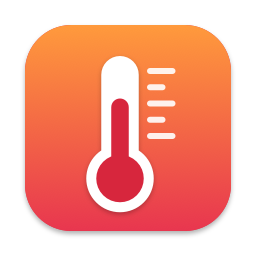
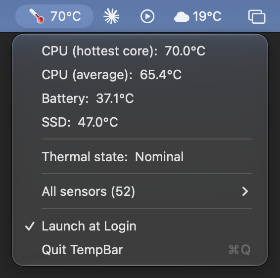

# TempBar

A tiny menu bar app that shows your Apple Silicon Mac's CPU temperature, plus battery, SSD and the macOS thermal state when you click it.



- The menu bar shows the hottest CPU core. The icon switches from 🌡 to 🔥 when macOS starts throttling (thermal state "Serious" or worse).
- The dropdown shows the hottest core, the CPU average, battery, SSD, the thermal state, and every temperature sensor the chip reports, plus a **Launch at Login** switch.
- It updates every 5 seconds and pauses while the display is asleep. On the tested Mac it uses about 0.1% of one CPU core and 17 MB of memory.

It's one Swift file with no dependencies.

## Requirements

- An Apple Silicon Mac (M1 or later). Intel Macs aren't supported.
- macOS 12 Monterey or later.

Tested on an M5 Pro running macOS 27.0.1. Other Apple Silicon chips and older macOS versions should work, but haven't been tested yet.

## Install

1. Download `TempBar.zip` from the [latest release](https://github.com/Fray2869/TempBar/releases/latest).
2. Unzip it and move `TempBar.app` to your Applications folder.
3. Open it. The temperature appears in the menu bar; there's no Dock icon.

### First launch: "Apple could not verify TempBar"

TempBar is not notarized. Notarizing requires a paid Apple Developer account, so the app is only signed locally ("ad-hoc"). macOS blocks apps like this the first time you open them:

1. Open TempBar and click **Done** on the warning.
2. Go to **System Settings → Privacy & Security** and scroll down to **Security**.
3. Next to "TempBar was blocked to protect your Mac", click **Open Anyway**, then confirm with your password or Touch ID.

On macOS 14 and earlier you can instead Control-click the app and choose **Open**. You only need to do this once.

If you'd rather not trust a downloaded binary, build it yourself from the source below.

## Build from source

Install Apple's command line tools if you haven't already:

```bash
xcode-select --install
```

Then build:

```bash
git clone https://github.com/Fray2869/TempBar.git
cd TempBar
bash build.sh
open TempBar.app
```

`build.sh` creates `TempBar.app` (and `TempBar.zip` for releases) next to the script.

The app icon is drawn in code by `make_icon.swift`. To change it, edit that file and run `swift make_icon.swift AppIcon.icns`.

## Launch at login

Click TempBar in the menu bar and choose **Launch at Login** (macOS 13 and later). Choose it again to turn it off.

On macOS 12, add it in **System Preferences → Users & Groups → Login Items** instead.

To quit TempBar, click it in the menu bar and choose **Quit TempBar** (⌘Q).

## Notes

- **Undocumented APIs.** TempBar reads the chip's temperature sensors through private IOKit HID functions, the same method used by apps like [Stats](https://github.com/exelban/stats) and Hot. Apple doesn't document these, so a macOS update could break them, and they're why TempBar can't be on the Mac App Store.
- **Privacy.** No network access, no admin rights, no data collected, and no files written.
- **Which sensors count as "CPU".** On Apple Silicon the CPU die sensors are named `tdie`. If a chip reports none, TempBar shows the hottest sensor instead.

## Releases

Pushing a tag like `v1.0.0` runs the GitHub Actions workflow in `.github/workflows/release.yml`, which builds the app on a macOS runner and attaches `TempBar.zip` to a new release.

## License

[MIT](LICENSE)
